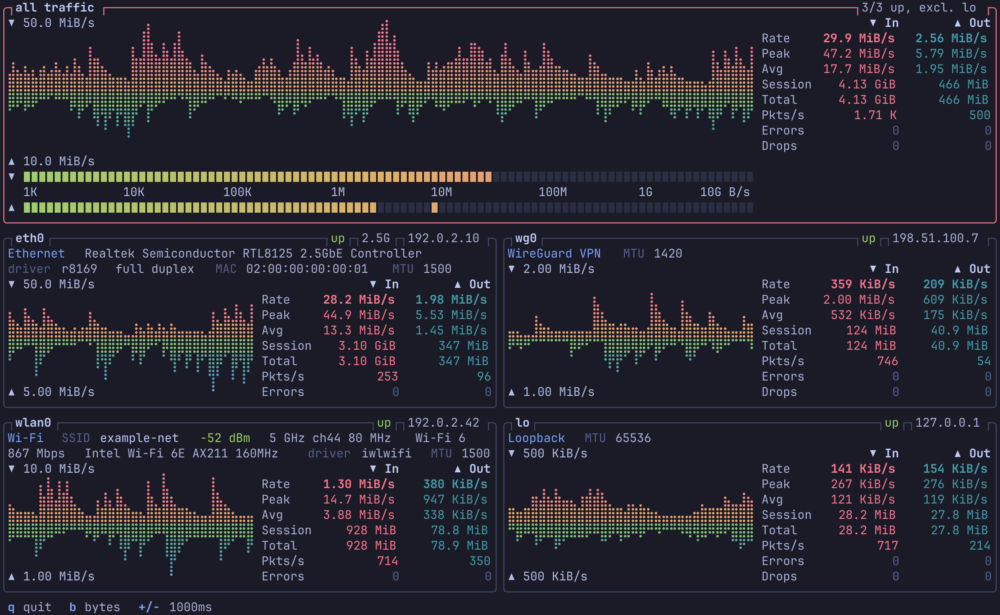

# nitop

[](https://github.com/cpknight/nitop/actions/workflows/ci.yml)
[](https://github.com/cpknight/nitop/releases/latest)
[](https://crates.io/crates/nitop)
[](LICENSE)

A [btop](https://github.com/aristocratos/btop)-style terminal monitor for network interfaces. It shows every interface at a glance, each in its own box, with one rollup of all your traffic on top.



*The screenshot uses made-up data.*

## Features

- **Like `ip a`, with live traffic:** a box per interface with its type, link, addresses, MAC and MTU, plus an in/out braille history chart and a table of rate, peak, average, session and kernel totals, packets, errors and drops.
- **An "all traffic" rollup** with stereo-style LED level meters: instant level plus a peak-hold marker.
- **What each interface is:** connection type, hardware name and driver, with speed and duplex on Ethernet. On Wi-Fi it adds SSID, signal, band, channel, width, generation and transmit rate, and on ZeroTier the network's name, ID, status and type.
- **Uses your btop theme** automatically, if you have one.
- **Light and self-contained:** a single binary that needs no root and no other tools. It uses `zerotier-cli` for live ZeroTier status if you have it.
- **Follows your system:** adapts to the terminal size, and picks up interfaces as they appear and disappear (VPNs, containers, USB adapters).

nitop shows traffic per interface. For per-connection or per-process traffic, use a tool like `iftop`, `nethogs` or `bandwhich`.

## Install

nitop runs on Linux only. It works on x86-64 and ARM64.

**Prebuilt binary:**

```sh
curl -L https://github.com/cpknight/nitop/releases/latest/download/nitop-x86_64-unknown-linux-musl.tar.gz | tar xz nitop
install -Dm755 nitop ~/.local/bin/nitop
```

For ARM64, use `nitop-aarch64-unknown-linux-musl.tar.gz`. Checksums are on the [releases page](https://github.com/cpknight/nitop/releases).

**From [crates.io](https://crates.io/crates/nitop)** (requires Rust 1.89 or newer):

```sh
cargo install --locked nitop
```

To build the latest unreleased code instead, run `cargo install --locked --git https://github.com/cpknight/nitop`.

## Usage

Run `nitop`. It has no options besides `--help` and `--version`.

| Key | Action |
| --- | --- |
| `q`, `Esc`, `Ctrl-C` | Quit |
| `b` | Show rates in bytes or bits |
| `+` / `-` | Slower / faster sampling (100 ms to 10 s) |
| Arrows, `j` `k`, `h` `l`, `PgUp` `PgDn` | Previous / next page of interfaces |
| `Home` / `End` | First / last page |

## Reading the display

- **Charts:** inbound grows up from the middle and outbound grows down. Each has its own scale, shown in the corner, so a small upload stays visible beside a large download. That means their heights can't be compared directly.
- **Level meters:** a fixed log scale from 1K to 10G, so a position always means the same rate. The bar jumps up instantly and falls smoothly. A single lit segment marks the recent peak, holding about 2.5 s before dropping. Readings arrive at the sampling interval, and the movement between them is animation.
- **Session, Peak and Avg** are measured since nitop started. **Total, Errors and Drops** are the kernel's counters.
- **The rollup** sums every interface except loopback. Tunnel traffic (VPN, ZeroTier) is counted on the tunnel and again on the physical link that carries it, so the rollup reads high while a tunnel is busy.
- **Layout:** the rollup runs across the top, with equally sized interface boxes below it, up to three across depending on width. If they don't all fit there are pages, and leftover slots stay blank.
- **Details** are on fixed rows, `type`, `link`, `inet`, `inet6` and `ether`, and a `—` means there's nothing to show. They line up across boxes. Boxes too short for all five show the most useful rows, and a value too long for its row is shortened, or counted as `+N` for extra addresses.

## Good to know

- **Hardware names** come from the `hwdata` package's `pci.ids` and `usb.ids`. Without it, or for a card it doesn't list, you see the numeric ID or a more general chip name.
- **VPN product names** (ZeroTier, Tailscale and so on) are inferred from the interface name for TUN/TAP devices, because the kernel doesn't record who owns one.
- **ZeroTier details** come from `zerotier-cli` if you have access to it, which also gives live status. Otherwise nitop reads the name, ID and type from the daemon's network files, which is its private format and could change. To get status without root, copy the auth token: `sudo install -m 600 -o "$USER" /var/lib/zerotier-one/authtoken.secret ~/.zeroTierOneAuthToken`. Treat that file like a password, as it allows control of the ZeroTier service.
- **Theme:** read at startup from `color_theme` in `~/.config/btop/btop.conf`. `Default` and `TTY` are btop's builtin themes, and those colors are what nitop uses when nothing else is set. Restart nitop to pick up a theme change.

## Contributing

Bug reports and pull requests are welcome. See [CONTRIBUTING.md](CONTRIBUTING.md). Hardware reports are especially useful: if an interface is labeled wrongly, please [open an issue](https://github.com/cpknight/nitop/issues/new/choose).

## Credits

nitop was written by [Claude](https://claude.com/claude-code), Anthropic's AI coding agent, working from the direction of its maintainer, [@cpknight](https://github.com/cpknight). The 0.2.1 corrections were made by [Grok](https://x.ai), xAI's coding agent, with the same maintainer. The look comes from [btop](https://github.com/aristocratos/btop), and the terminal UI is built with [ratatui](https://ratatui.rs).

## License

[MIT](LICENSE)
